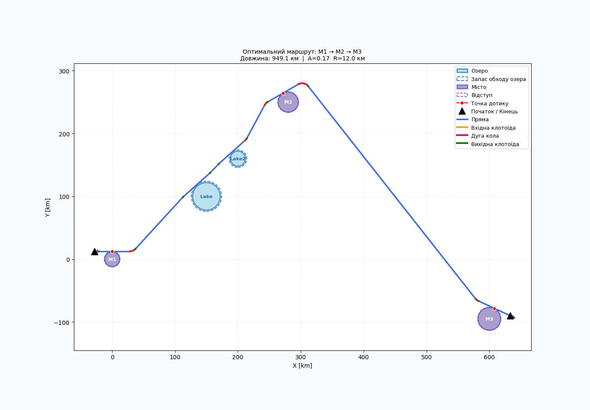

# Clothoid road-route optimiser

Individual geometric-modelling project that constructs a road through multiple cities using straight segments and clothoid–circle–clothoid transitions while respecting city and obstacle exclusion zones.



## Mathematical and computational features

- clothoid coordinates computed from Fresnel integrals
- tangent, circular-arc and coordinate-transformation geometry
- single- and two-figure transition construction
- numerical compatibility solving for difficult transitions
- segment/circle collision detection
- automatic obstacle insertion and lake avoidance
- nearest-neighbour route construction followed by 2-opt improvement
- interactive Tk/Matplotlib interface and scenario visualisation

## Run

```bash
python -m venv .venv
source .venv/bin/activate
pip install -r requirements.txt
python src/app.py
```

Tkinter must be available in the local Python installation.

## Structure

```text
src/app.py                         Single-file application
figures/                           Example model and interface images
report/geometric_modelling_project.pdf
```

## Technology

Python, NumPy, SciPy, Matplotlib and Tkinter.

## Academic context

Individual KPI Foundations of Geometric Modelling project, 2026. The report documents the mathematical model, algorithms and scenario analysis.
